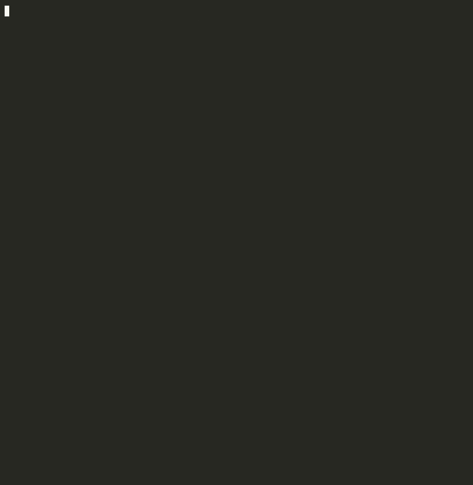

# Multi-Agent Workspace Guardian

Preflight coordination for developers running several AI coding sessions (Claude Code worktrees
first) on one Git repository: declare which task owns which paths, get warned before two sessions
collide, and hand off work with evidence of what was actually tested.

**Status:** G1 desk research done (`docs/RESEARCH_G1.md`). G2 prototype starts from the existing
session-agents mod. See `docs/MASTER_PLAN.md` for the plan and `docs/MOD_REVIEW.md` for the review.

## See it

**Risky overlap caught before merge.** Two tasks claim the same path, the same file is changed in two worktrees, and two migrations under different names are flagged as one hotspot. Every finding ends with a fix; `--strict` exits 3.


**Clean repo.** Two well-separated tasks, each mapped to its worktree, and a suggested merge order.


**Evidence-based handoff.** The report says **not verified** until guardian ran the tests itself, then records the exit code and a fingerprint of the tree they ran on.



Reproduce them with `bash demo/scenarios.sh` (see `docs/DEMO.md`).

## What is here today

| Path | What it is |
|---|---|
| `plugins/session-agents/` | Working Claude Code mod v0.15.0: `/sessions` control pane, `/task` ownership shared across worktrees with an ask-the-user hold on violations, live session list, file claims, edit pause, peer messaging, git/worktree view. Docs in `docs/SESSION_AGENTS_MOD.md`. |
| `.claude-plugin/marketplace.json` | Makes this repository a plugin marketplace. |
| `LICENSE` | PolyForm Shield 1.0.0: free to use, including at work, and to modify; not permitted to use it to provide a competing product. Paid features live in a separate private repository. |
| `scripts/git-parallel-session-check.sh` | `UserPromptSubmit` hook that warns when another session shares this checkout. |
| `src/` | `guardian` CLI skeleton (TypeScript). Commands are stubs until G2. |
| `docs/` | Master plan, G1 research, mod review, execution tracker, launch playbook. |

## Install the mod

```
/plugin install session-agents --marketplace d10or/workspace-guardian
```

Then start a new session and type `/sessions`. Declare ownership with `/task add AUTH 'src/auth/**' --branch feature/auth`. Replace `d10or/workspace-guardian` once this repository is
pushed to GitHub.

## Install the shared-checkout hook

```sh
mkdir -p ~/.claude/hooks
cp scripts/git-parallel-session-check.sh ~/.claude/hooks/
chmod +x ~/.claude/hooks/git-parallel-session-check.sh
```

Then add it to `UserPromptSubmit` in `~/.claude/settings.json` (merge, do not replace):

```json
{ "hooks": { "UserPromptSubmit": [ { "hooks": [
  { "type": "command", "command": "bash \"$HOME/.claude/hooks/git-parallel-session-check.sh\"" }
] } ] } }
```

## The `guardian` CLI (v0.1)

Reads and writes the same `.guardian/tasks.json` as the mod, so a task declared with `/task add`
in Claude Code is what `guardian check` reports on, and vice versa.

| Command | Effect |
|---|---|
| `guardian inspect [--json]` | Branch, head, base, every worktree with uncommitted and committed-since-base counts, locks and in-flight git operations, and which worktree carries each task. Read-only. |
| `guardian task add --id AUTH --paths 'src/auth/**' --branch feature/auth [--note …] [--yes]` | Declare ownership. Previews, asks for confirmation (or `--yes`), then writes the task file atomically. Warns on declared overlaps. |
| `guardian task done --id AUTH` / `guardian task list [--all]` | Release a task's paths / show tasks and declared overlaps. |
| `guardian check [--json] [--strict] [--base <ref>]` | Declared overlaps, the same path changed in two worktrees, paths owned by another task, paths outside a task's claim, hotspot categories (lockfiles, migrations, schemas, generated code, routes, config) touched by several worktrees, worktrees behind base, in-flight git operations, unresolved conflicts, stale tasks. Each finding carries a fix. `--strict` exits 3 when risks exist. Advisory: it flags risk, never certifies a merge. |
| `guardian handoff --task AUTH [--run 'npm test'] [--evidence file] [--out report.md] [--json]` | Markdown or JSON: task, branch and head, ahead/behind base, commits since base, changed paths with "outside claim" marks, test evidence, open risks, next steps. Tests are **verified** only when guardian ran them itself (`--run`) and records the exit code plus a fingerprint of the tree they ran on. Supplied output is marked **supplied, not verified**. Otherwise **not verified**. |

Guardian never runs checkout, rebase, merge, push, reset, or delete on your behalf. Git is called with
argument arrays, never a shell string. JSON output carries `schemaVersion: 1`.

## Development

Mod (needs Claude Code 2.1.287+):

```sh
claude plugin validate plugins/session-agents
claude plugin test plugins/session-agents
bash tests/hook.test.sh
```

CLI (Node.js 22+):

```sh
npm install
npm test          # unit tests + an end-to-end suite on a throwaway repo with two worktrees
npm run dev -- check --json
npm run build && node dist/index.js --help
```

## Layout

```
.claude/            project settings (SessionStart hook) and skills: /checkpoint, /resume, /gate
.claude-plugin/     marketplace manifest
plugins/            Claude Code plugins and mods
scripts/            shell hooks
docs/               plan, research, checkpoint (living state), progress log, tracker, audits, guides
src/                CLI source (TypeScript, ESM)
tests/              node:test suites and fixtures
.guardian/          local task state, git-ignored
```
